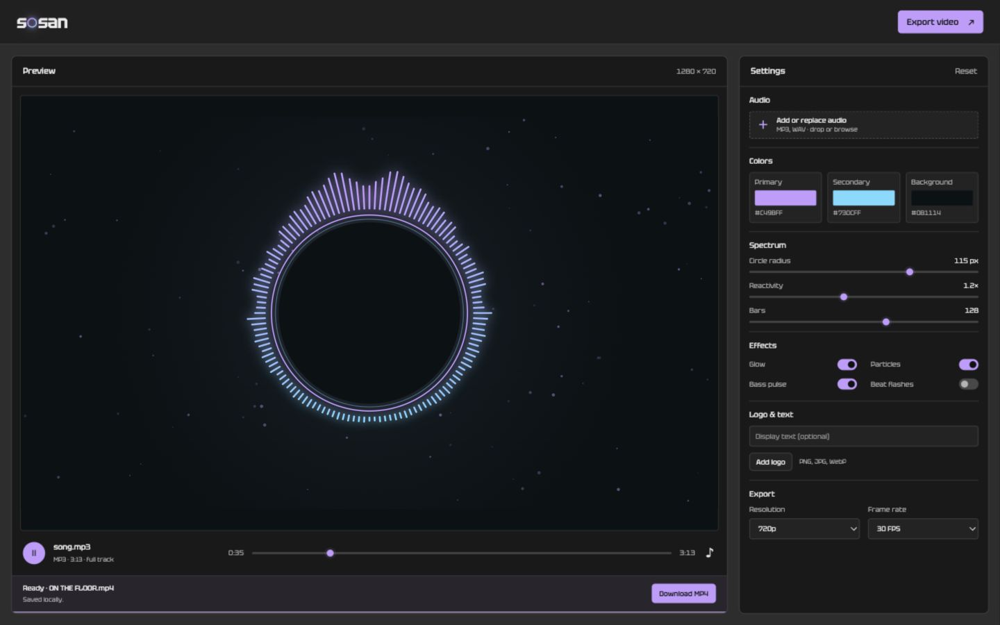

# sosan

A local, audio-reactive music visualizer with a live browser preview and offline
MP4 export. Built with Python, Web Audio, Canvas, OpenCV, and FFmpeg.



## Features

- Drag and drop MP3 or WAV audio.
- Customize spectrum colors, radius, reactivity, bar count, glow, particles,
  bass pulses, and beat flashes.
- Add a logo or optional display text.
- Export the full song at 480p, 720p, or 1080p, with 30 or 60 FPS.
- Close the browser after upload; rendering continues in a background process.
- Reopen the studio to recover progress, cancel a job, or download the MP4.
- Keep audio, images, analysis, and rendering on your computer.

## Requirements

- Python 3.10 or newer.
- FFmpeg and FFprobe available on your `PATH`.
- A modern browser with Web Audio support.

No Node.js installation or frontend build is needed to run the app.

## Quick start

Clone this repository and open its directory:

```sh
git clone https://github.com/Swappuri/sosan.git
cd sosan
```

Install FFmpeg using your platform's package manager. For example:

```sh
# macOS (Homebrew)
brew install ffmpeg

# Ubuntu / Debian
sudo apt-get update
sudo apt-get install ffmpeg

# Windows (WinGet)
winget install --id Gyan.FFmpeg -e
```

Create a virtual environment and install the Python dependencies:

```sh
python3 -m venv .venv
source .venv/bin/activate
python -m pip install -r requirements.txt
python server.py
```

On Windows, use `py -m venv .venv` to create the environment and
`.venv\Scripts\Activate.ps1` to activate it in PowerShell.

The server opens **http://127.0.0.1:8765**. On macOS, you can also double-click
`Open sosan.command` after setup; it uses the local `.venv` when present.

```sh
python server.py --port 8766        # Use another port
python server.py --no-browser      # Start without opening a browser
```

## Usage

1. Add your own MP3 or WAV file. No songs or sample recordings are bundled.
2. Play the preview and adjust the settings. On smaller windows, switch between
   the Preview and Settings views.
3. Optionally add a PNG, JPG, or WebP logo, or enter display text.
4. Select the export resolution and frame rate, then click **Export video**.
5. Keep the page open during the initial upload. Once analysis or rendering
   starts, you can close it and return later to download the finished MP4.

An export captures the settings and logo selected when you submit it. Later
preview changes do not affect the active job. Only one export renders at a time.

## How export works

The renderer analyzes the full song and generates frames using a fixed video
clock. FFmpeg combines those frames with the original audio into an H.264/AAC
MP4. This does not record browser playback or capture your screen.

Rendering speed depends on your computer, resolution, and effects. Keep the
computer awake. Started workers survive closing the server terminal; restart
the server to check status or download. Shutting down the computer interrupts
an unfinished job. Font rasterization, glow, and audio response can differ
slightly between the browser preview and the offline renderer.

The local server accepts audio up to 512 MB and logos up to 20 MB. It binds only
to `127.0.0.1`; this is a local desktop tool, not an Internet-facing web service.

## Local files and privacy

Completed videos, job settings, status, and logs are stored in `exports/<job-id>/`.
Temporary uploaded source copies and partial videos are removed when a worker
finishes or is cancelled. Finished export folders can be removed when no longer
needed. The browser remembers the latest export ID in local storage.

Source audio, generated media, exports, credentials, and virtual environments are
excluded by `.gitignore`. Do not add personal songs or rendered videos to the
repository. All included fonts and UI assets are served locally.

## Development

Run from the repository root:

```sh
python -m unittest discover -s tests -v
python -m compileall -q server.py render_worker.py render_settings.py offline_renderer.py
node --check studio/app.js
```

Node.js is needed only for the optional JavaScript syntax check. Tests generate
their own audio fixtures; none require a personal song. FFmpeg and FFprobe must
be installed to exercise encoding checks. GitHub Actions runs these checks on
Python 3.11 and 3.12.

```text
sosan/
├── .github/workflows/ci.yml
├── docs/studio.png
├── studio/
│   ├── fonts/                 # Tektur and its SIL license
│   ├── index.html
│   ├── style.css
│   └── app.js
├── tests/test_offline_export.py
├── server.py                  # Local HTTP server and export API
├── render_settings.py         # Settings validation
├── render_worker.py           # Background jobs, progress, encoding, cleanup
├── offline_renderer.py        # Audio analysis and frame rendering
├── requirements.txt
├── Open sosan.command         # macOS launcher
├── LICENSE
└── THIRD_PARTY_NOTICES.md
```

## License

Application code is licensed under the [MIT License](LICENSE).
Tektur is licensed separately under the SIL Open Font License; see
[third-party notices](THIRD_PARTY_NOTICES.md).
